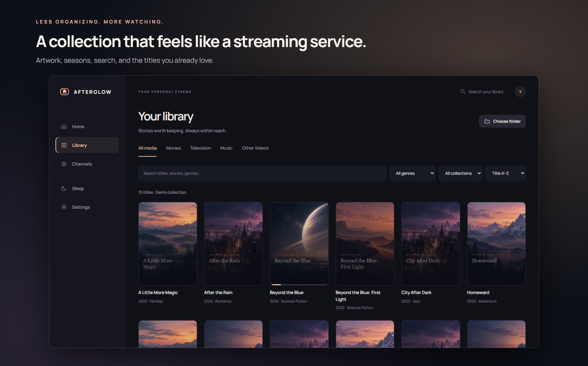
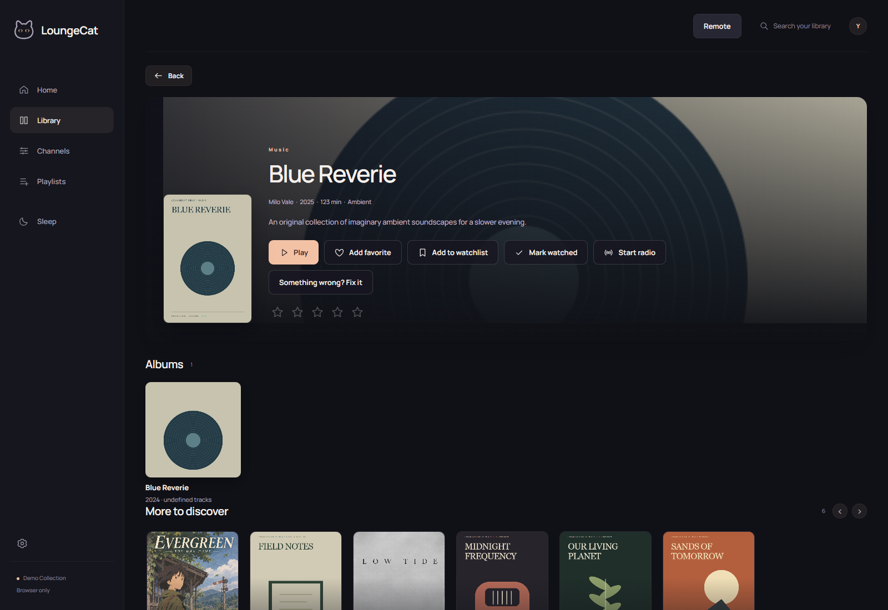
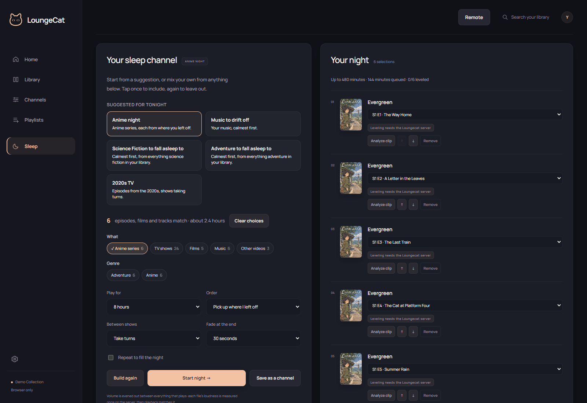

  

# Your media deserves a better home.

Turn the folders you already have into a streaming experience you’ll want to come back to. **Afterglow brings your movies, TV, anime, and music together in a clean, beautiful browser interface.**

Pick your media folders. Afterglow takes care of the busywork: finding titles, fetching artwork and descriptions, organizing episodes, and watching for new additions. Spend your evening enjoying your collection instead of organizing it.

### [↓ Download Afterglow for Windows](https://github.com/ShnerpLabs/afterglow-releases/releases/latest)

**[shnerplabs.com](https://shnerplabs.com)**: setup guide, [Linux and NAS](https://shnerplabs.com/linux-server), and [how Afterglow compares with Plex](https://shnerplabs.com/afterglow-vs-plex).

**Windows PC hosts your library · Watch in a browser on your home network · Your files stay on your server**

## Three steps to your next great night.

1. **Install Afterglow** on the Windows computer that holds your media.
2. **Choose your folders.** Add movies, shows, anime, music—or all of them.
3. **Press play.** Open Afterglow on that computer, or visit its local address from another device on the same network.

Afterglow runs quietly in the system tray, regularly rescans your folders, and checks for app updates. Add something new to a folder and let your library catch up.

## Less sorting. More discovering.

**A collection that feels like a streaming service.** Artwork, descriptions, seasons, search, favorites, and continue watching make even a sprawling collection feel inviting. Films, series, anime, and albums each get a place of their own.

- **Find something you’re in the mood for.** Home brings together related stories, favorite genres, movie series, and things to pick up again.
- **Let a channel choose.** Library-driven channels turn your collection into something you can simply tune into. Favorite the ones you love.
- **A place for everyone.** Fun creature avatars and separate profiles keep tastes and watching progress personal. With a server profile, pick up on another device.
- **Play with one click.** Start from Home or Library, resume where you left off, and let episodes keep going.

## Bring the files you already have.

**Movies in MKV? Music in FLAC? A collection built over years? Make yourself at home.**

Afterglow combines browser playback with server-side video and audio conversion powered by FFmpeg. Compatible files play directly; supported formats that need help are converted for the receiving device as they play.

| Video | Audio |
| --- | --- |
| MKV, MP4, AVI, MOV, WebM, and more | MP3, FLAC, AAC, WAV, Ogg, and more |
| H.264, HEVC/H.265, and other FFmpeg-supported codecs | Browser-compatible audio plus server conversion for supported additional codecs |

Subtitles, audio-track selection, fullscreen, and quality controls keep you in charge. Send playback to compatible TVs or speakers, or open Afterglow in another device’s browser on your home network.

Format support depends on the file, server hardware, browser, and receiving device. Encrypted or DRM-protected media is not supported; cast options depend on the receiver.

## Give your music a little atmosphere.

Your tracks become browsable albums, with artist and cover information where available. Let an album play through while ambient landscapes give the screen something beautiful to do.

## And when the day is done…

**Keep your comfort shows close.** Optional Sleep Studio builds a familiar queue from your own collection. Choose genres, shows, seasons, music, and more—or start with a suggested mix. Set the length of your night, soften volume changes, and fade gently at the end.

Want to tune every detail? Edit the queue and sound settings. Want an easy evening? Choose a mix and settle in. Sleep Studio is there when you want it; everyday watching stays front and center.

## A few things to know

**Does it include movies or music?** You bring your own media. Afterglow organizes and plays it; it is not a streaming subscription or content download service. Screenshots show the real app with an illustrative, fictional demo library and original artwork.

**Does it move or upload my collection?** Your media stays in its folders on your server. Online title matching and artwork lookup contact metadata providers; they need an internet connection. Other devices stream from your server over your network.

**Does my computer need to stay on?** Yes. The Windows computer running Afterglow serves your library to the other devices in your home.

**What do I download?** Open the latest release below and download **AfterglowSetup-…exe** from its Assets. Run the installer, launch Afterglow, and choose your folders. The `.sig` asset is an update-verification file, not the installer.

**What if a title is hard to identify?** Afterglow tries automatic matching first. You can correct a title or choose its match when needed.

### [Make yourself at home. Download Afterglow →](https://github.com/ShnerpLabs/afterglow-releases/releases/latest)

[Latest release & changes](https://github.com/ShnerpLabs/afterglow-releases/releases/latest) · [Report a problem](https://github.com/ShnerpLabs/afterglow-releases/issues)
