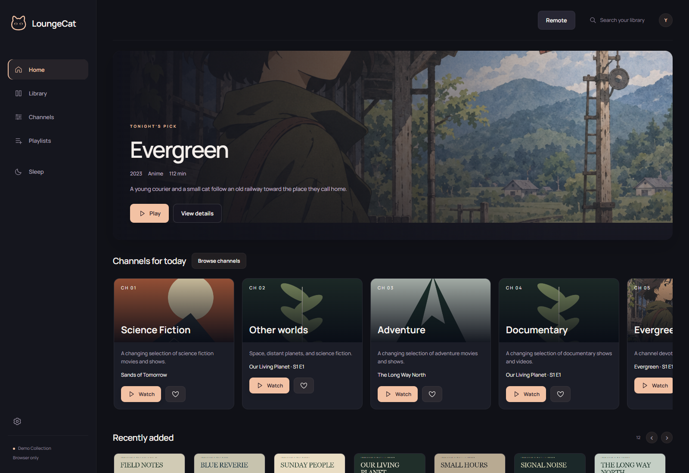
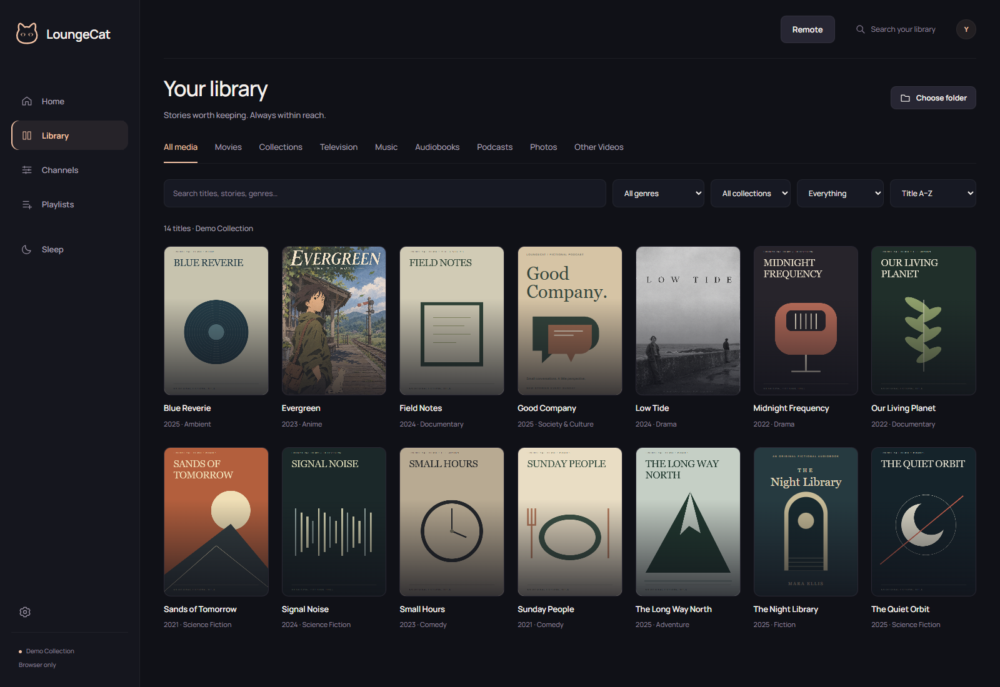
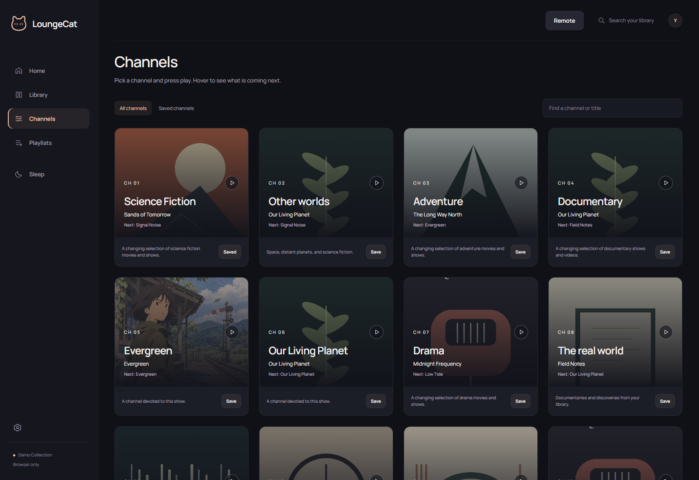
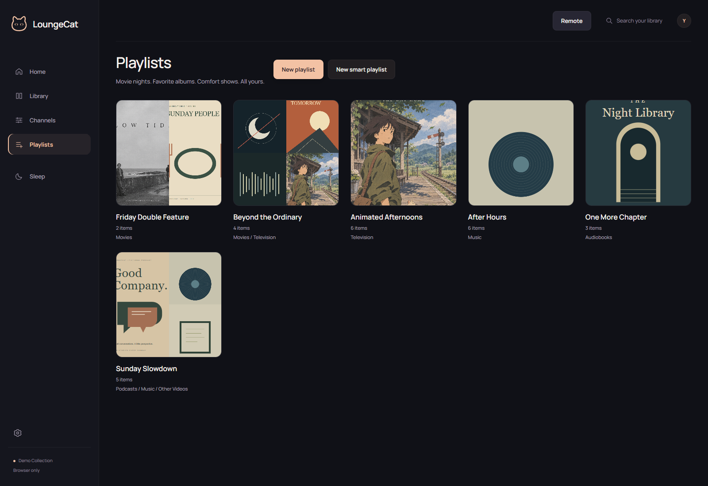

# LoungeCat

**Your movies, shows, anime, music, audiobooks and podcasts. One simple home.**

Pick your media folders. LoungeCat finds titles and artwork, organizes your collection, and makes it easy to watch or listen on your devices.

### [Download LoungeCat](https://shnerplabs.github.io/loungecat-releases/)

[Website](https://shnerplabs.com) | [Setup guide](https://shnerplabs.com/get-started) | [Linux and NAS](https://shnerplabs.com/linux-server) | [Latest release](https://github.com/ShnerpLabs/loungecat-releases/releases/latest)

## Three steps. Then press play.

1. **Install the server** on the computer that holds your media.
2. **Choose your folders.** Add films, shows, anime, albums, books and podcasts.
3. **Connect your devices.** Use a browser or install a client for your phone or another computer.

Your collection stays in its folders. The computer running your server needs to stay on while other devices use it.

## Everything on your shelves, easy to find.

Search, artwork, descriptions, favorites, profiles and continue watching help you find your next good thing. Correct a title or choose another match when the automatic lookup needs a hand.

## Pick a channel. Settle in.

Channels are built from your collection. Click a tile to play, hover to see what comes next, and save the channels you love.

## A playlist for every kind of evening.

Double features, comfort shows, late-night albums or another chapter. Create a playlist, browse a compact view of your library, and add films, episodes, tracks, books and podcasts in the order you choose.

## Your music, by album and track.

Browse artists and albums, pick tracks, or let an album play through. Audio controls and visualizers are there when you want them.

## A quieter end to the day.

Build a familiar sleep mix from your collection. Choose shows, genres, seasons, music and more, set a duration, arrange the queue and adjust the sound.

## Bring the files you already have.

Compatible files play directly. Supported formats that need conversion use FFmpeg on the server. Playback support depends on the file, browser, server hardware and receiving device.

| Video | Audio |
| --- | --- |
| MKV, MP4, AVI, MOV, WebM and more | MP3, FLAC, AAC, WAV, Ogg and more |

Subtitles, audio-track selection, fullscreen and quality controls keep you in charge. Encrypted or DRM-protected media is not supported.

## A few things to know

**Is media included?** No. You bring your own collection. Every screenshot here uses original fictional demonstration media and playlists. No personal library is shown.

**Does my collection move or get uploaded?** Media stays in your folders. Online matching and artwork lookup contact metadata providers. Other devices stream from your server.

**What do I download?** Use the platform links on the download page. Files ending in `.sig` are update-verification files, not installers. Existing installer filenames remain compatible while the app name changes.

**Need help?** [Start with the setup guide](https://shnerplabs.com/get-started), [compare with Plex](https://shnerplabs.com/loungecat-vs-plex), or [report a problem](https://github.com/ShnerpLabs/loungecat-releases/issues).

### [Make yourself at home. Get LoungeCat.](https://shnerplabs.github.io/loungecat-releases/)
